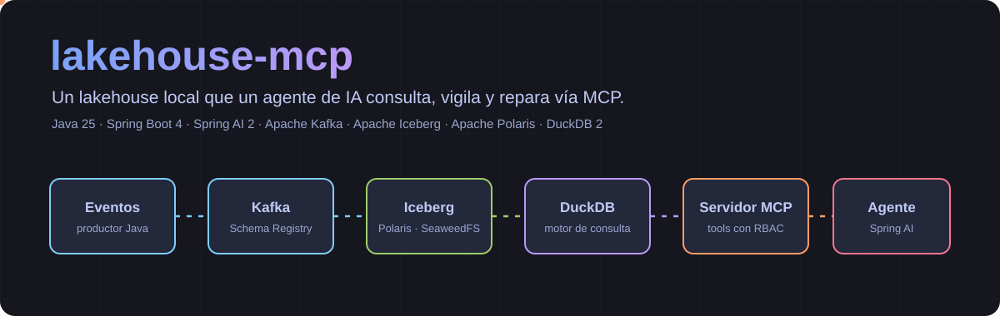
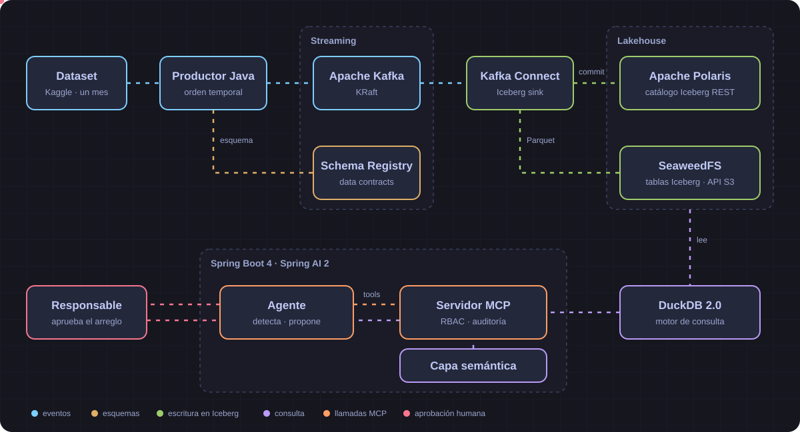
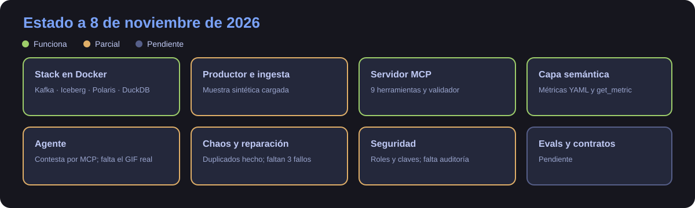
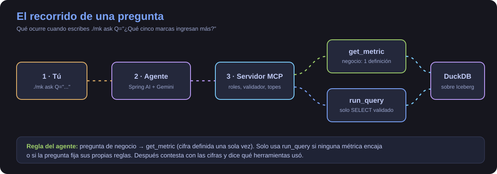
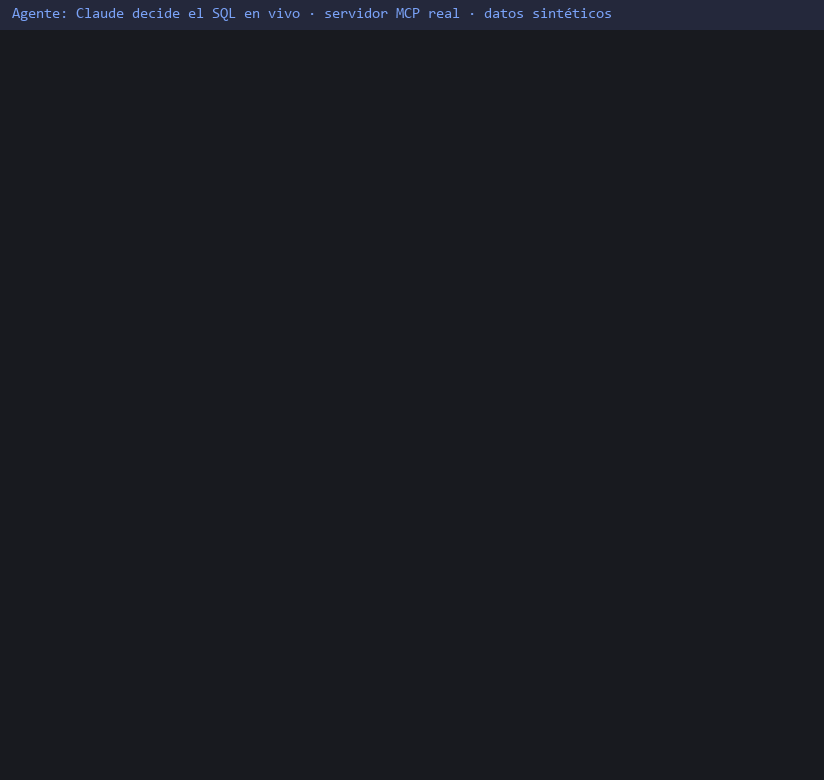

<p align="center">
  
</p>

<p align="center">
  
  
  
  
  
  
  
</p>

<p align="center">
  <b>Un lakehouse local que un agente de IA consulta, vigila y repara vía MCP.</b><br>
  Streaming a Iceberg · capa semántica · self-healing con aprobación humana · evals con verdad de referencia. Solo necesita Docker.
</p>

> 🇬🇧 **In English:** a local modern lakehouse that an AI agent queries, monitors and repairs through MCP. A Java producer
> replays real e-commerce events into Apache Kafka; the Iceberg Kafka Connect sink writes them to Apache Iceberg tables,
> catalogued by Apache Polaris on SeaweedFS and queried with DuckDB 2.0. A Spring AI agent reaches them through an MCP server.
> **Work in progress:** the infrastructure runs and is verified end to end by a smoke test; the producer, MCP server, agent,
> and evals are being built. Everything runs in Docker.

> [!NOTE]
> **Estado: infraestructura, servidor MCP, capa semántica y agente funcionan; la demo está grabada con un cliente MCP.** Hoy funciona lo marcado como ✅ en [Qué hay y qué falta](#qué-hay-y-qué-falta).
> Aquí no se publica ninguna cifra de precisión ni de rendimiento hasta que exista la medición que la respalde.

## El problema

Un agente que escribe SQL contra un lakehouse impresiona en una demo y asusta en producción. Inventa definiciones de negocio,
puede lanzar cualquier consulta, y nadie sabe si acierta. Cuando el pipeline falla, además, suele ser una persona quien lo
descubre leyendo un dashboard. Este proyecto pone al agente delante de esos problemas:

| Lo que pasa en producción | Qué lo resolverá aquí |
|---|---|
| Cada cual **calcula las métricas a su manera** | Capa semántica en YAML: el agente pide la métrica, no improvisa SQL |
| Un agente **lanza lo que se le ocurre** | `run_query` solo admite `SELECT` validados y con límite de filas |
| Un productor **cambia el esquema y rompe a los demás** | Data contracts en Schema Registry: un test rompe el build |
| Se cae un consumidor o **llegan duplicados** | `make chaos` inyecta el fallo; el agente detecta, diagnostica y propone el arreglo |
| Un arreglo automático **empeora las cosas** | `apply_fix` solo se ejecuta con aprobación humana, y después se verifica |
| Nadie sabe **si el agente acierta** | 20-30 preguntas con la respuesta calculada de forma independiente |
| Quien mira los datos **no debería verlo todo** | RBAC en las tools, log de auditoría y `user_id` enmascarado |

## Arquitectura

<p align="center">
  
</p>

<p align="center"><sub>Es el diseño completo: lo que ya funciona está en <a href="#qué-hay-y-qué-falta">Qué hay y qué falta</a>.</sub></p>

| Pieza | Versión | Para qué |
|---|---|---|
| Apache Kafka (KRaft) | 4.4.0 | Transporte de eventos, sin ZooKeeper |
| Confluent Schema Registry | 8.4.0 | Esquemas versionados y reglas de compatibilidad |
| Iceberg Kafka Connect sink | 1.12.0 | Escribe de Kafka a Iceberg |
| Apache Polaris | 1.8.0 | Catálogo REST de Iceberg |
| SeaweedFS | 4.51 | Almacenamiento compatible con S3 |
| DuckDB | 2.0.0 | Motor de consulta (extensión `iceberg`) |
| Java · Spring Boot · Spring AI | 25 · 4.1.2 · 2.0.2 | Productor, servidor MCP y agente |

## La wiki

¿No sabes qué es un lakehouse? ¿O quieres ver exactamente lo que hay montado? [**La wiki**](docs/wiki/README.md) sirve para las dos cosas: conceptos desde cero, el viaje de un evento,
una página por cada pieza (qué es, cómo se conecta, cómo está configurada y cómo probarla), [un tutorial paso a paso](docs/wiki/03-probarlo.md) y [guía de diagnóstico](docs/wiki/04-operacion.md).

## Qué hay y qué falta

<p align="center">
  
</p>

| | Pieza | Estado |
|---|---|---|
| ✅ | Stack en Docker Compose, con healthchecks | Arranca con `./mk up` |
| ✅ | Ida y vuelta DuckDB → Polaris → SeaweedFS | Lo comprueba `./mk smoke` |
| ✅ | Conector de Iceberg y muestra sintética | Cargada de verdad: 50 000 filas en `ecommerce.events` (8-nov) |
| ✅ | Servidor MCP | Nueve herramientas (`list_tables`, `describe_table`, `run_query`, `get_metric`, `pipeline_health`, `data_quality_check`, `time_travel`, `propose_fix`, `apply_fix`), validador de SQL de solo lectura y roles analyst/admin por clave |
| ✅ | Capa semántica | Métricas en YAML con `get_metric`; la referencia de la demo coincide con la métrica |
| 🟡 | Agente (Spring AI, Gemini por defecto, Claude por configuración) | Contesta por MCP y respeta topes. Ensayado con Gemini el 8-nov: las cinco marcas y sus importes cuadran con la referencia. El GIF de la demo usa un cliente MCP, no este agente |
| 🟡 | Self-healing con `./mk chaos` | Hecho el ciclo de duplicados; faltan partición vacía, consumidor caído y schema drift |
| 🟡 | Seguridad | Hechos roles y claves, con prueba de 401/403; falta la auditoría y el enmascarado de `user_id` |
| 🟡 | Productor y mes real | Muestra sintética funciona; el mes real de Kaggle sigue sin probarse |
| ⬜ | Data contracts, compactación, evals en CI | Planificado |

## La demo

<p align="center">
  
</p>

> [!NOTE]
> **Cómo se grabó este GIF:** un agente (Claude, sin ver ningún SQL previo) recibió solo la pregunta y las herramientas del servidor MCP, y **decidió él** qué llamar y qué SQL escribir.
> Las llamadas, los errores y las respuestas del servidor son reales, y el texto final es el suyo, sin editar. La animación está dibujada (no es una captura de pantalla) y el SQL va abreviado.
> Es Claude, no el agente propio de Spring AI: ese está ensayado con Gemini pero aún sin grabar. Los registros completos están en [`docs/media/live-agent/`](docs/media/live-agent/); el primer intento, antes de arreglar un fallo del servidor, también.

<p align="center">
  
</p>

Una pregunta de negocio va por la capa semántica; una consulta suelta, por `run_query`. Los datos son **sintéticos** (mismo esquema que el dataset real).

Guion completo: [docs/demo-grabacion.md](docs/demo-grabacion.md) · Explicación paso a paso: [wiki, la demo](docs/wiki/06-demo.md).

## Rendimiento medido

Medido el 8 de noviembre de 2026 con el mes real de octubre de 2019 (42,4 M de filas) en un PC con 7,6 GiB de RAM para Docker, sin clúster.

| Qué | Resultado |
|---|---|
| Eventos reales ingeridos | **1 059 008** (2,5 % de las sesiones del mes, enteras), leídos de 42 448 764 filas en 2 min 25 s, unos 7 000 por segundo |
| Recuento en Iceberg | **1 109 008** filas = 50 000 sintéticas + 1 059 008 enviadas: sin pérdidas ni duplicados |
| Memoria máxima por contenedor | Connect 826 MiB · Kafka 449 · Polaris 287 · Schema Registry 282 · servidor MCP 264 · SeaweedFS 209 · Postgres 46; ningún contenedor murió por falta de memoria |
| Consultas de la batería sobre esa tabla | **16 de 16 responden en 0,1–0,6 s** cada una (3,1 s en total), con ventanas, CTE, cohortes y z-score |

Qué **no** dice: solo se ingirió ~1 M de filas, no los 42 M; las consultas son una pasada con el servidor caliente, sin repetir ni medir percentiles; y la tabla mezcla filas reales con la muestra sintética. Para repetirlo: `./mk seed SAMPLE=0.025`. El perfil completo del mes está en [docs/data-profile.md](docs/data-profile.md).

## Cómo ejecutarlo

Solo necesitas Docker. En Windows, usa `mk.cmd` en lugar de `./mk`.

```bash
cp .env.example .env   # y cambia las contraseñas
./mk up                # la primera vez tarda: compila el conector de Iceberg
./mk smoke
```

`./mk smoke` termina con `duckdb -> polaris -> seaweedfs ok` cuando todo responde.

| Otras formas | |
|---|---|
| Cargar la muestra sintética, sin Kaggle (con el stack arriba; repetirlo duplica filas) | `./mk seed-sample` |
| Preguntar al agente (con el stack arriba y la clave en `.env`; sin probar con un modelo de verdad) | `./mk ask Q="How many rows does the events table have?"` |
| Descargar el dataset (necesita `~/.kaggle`) | `./mk download-data` |
| Otro mes | `./mk download-data MONTH=2019-Nov` |
| Reproducir el mes en Kafka (con el stack arriba; sin probar con el CSV real) | `./mk seed` (por defecto 1 % de las sesiones a 3600×) |
| Otra muestra, velocidad o mes (sin probar con el CSV real) | `./mk seed MONTH=2019-Nov SAMPLE=0.1 SPEEDUP=60` |
| Ver el estado de los servicios | `docker compose ps` |
| Ver los logs de un servicio | `docker compose logs --tail 50 connect` |
| Maven dentro del contenedor | `./mvnw verify` |
| Apagar | `./mk down` |
| Apagar y borrar los datos | `docker compose down -v` |

Los objetivos `evals`, `chaos` y `demo` ya existen en el `Makefile`, pero todavía avisan de que no están implementados.

## Los datos

[eCommerce behavior data from multi category store](https://www.kaggle.com/datasets/mkechinov/ecommerce-behavior-data-from-multi-category-store),
publicado en Kaggle por mkechinov con datos de REES46 Marketing Platform. Son eventos reales de una tienda (`view`, `cart`, `purchase`), y
se usa un solo mes, de 5,6 GB sin comprimir.

Su licencia en Kaggle es «Data files © Original Authors». Por eso **los datos no están en este repositorio**: se descargan con tus propias
credenciales, y la muestra de los tests es sintética, con el mismo esquema. Los datos sucios del origen se conservan a propósito, como casos de calidad.

## Decisiones y su porqué

| Decisión | Por qué | Lo que cuesta |
|---|---|---|
| **SeaweedFS** frente a MinIO | El repositorio comunitario de MinIO está archivado y sin mantenimiento. SeaweedFS es Apache-2.0 y habla S3 | Es menos conocido, y sin STS: Polaris no entrega credenciales temporales, así que cada cliente usa claves S3 estáticas |
| **Todo en Docker**, incluidas las herramientas | El proyecto se clona y se ejecuta sin instalar JDK 25, Maven ni make | Cada comando arranca un contenedor, y hay que montar el socket de Docker en `tools` |
| **Sin bind mounts** fuera de `tools` | `./mk up` corre dentro de un contenedor y sus rutas no existen en el host. La configuración va dentro de las imágenes | Cambiar una configuración exige reconstruir la imagen |
| **Conector compilado desde el código** | El proyecto Iceberg no publica el zip: su documentación indica compilarlo | El primer arranque tarda unos minutos más |
| **Capa semántica** en vez de SQL libre | Una métrica de negocio tiene una sola definición, revisable en un diff | Hay que declarar cada métrica antes de poder usarla |

El diseño completo, con las alternativas descartadas, está en [docs/architecture.md](docs/architecture.md).

## Tests

```bash
./mk test         # Java, con Testcontainers
./mk test MODULE=producer   # solo los tests de ese módulo
./mk test-board   # el panel de agentes
./mk smoke        # el stack levantado, de punta a punta
```

Los módulos Java aún no tienen código ni tests propios: de momento `./mk test` solo comprueba que el proyecto compila y sus dependencias se resuelven.

## Hecho con agent-board

Este proyecto se planifica y se construye con [agent-board](https://github.com/AlbaAsca/agent-board): un kanban en el que un equipo de agentes de Claude Code
(arquitecto, desarrollador, tester, investigador y experto) trabaja por tarjetas estimadas. El panel está en [`board/`](board) y el historial de commits muestra
qué tarea produjo cada cambio. El tester construye las respuestas de referencia de las evals sin mirar la implementación.

```bash
python board/server.py   # http://localhost:8020
```

## Limitaciones y siguientes pasos

Es un proyecto de portfolio, no una plataforma de producción, y está a medio construir:

- **El catálogo de Polaris se guarda en Postgres.** Un test demuestra que sobrevive a un reinicio de Polaris en contenedores de prueba; falta comprobarlo en el stack completo.
- **Un solo nodo de todo.** Un broker y una instancia de cada servicio, con unos 8 GB de RAM para Docker.
- **Secretos locales.** Las credenciales son claves estáticas en `.env`, adecuadas para una demo local.
- **Coste de las evals.** Llaman a un modelo de pago, así que no pueden lanzarse enteras en cada push.

## Licencia

[MIT](LICENSE). El dataset tiene su propia licencia: mira [Los datos](#los-datos).
