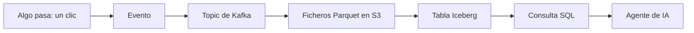

# Conceptos desde cero

No hace falta saber nada de datos. Cada término trae una analogía y, si procede, lo que significa en este proyecto. Las demás páginas enlazan aquí.

[Volver a la portada](README.md)

## El camino de un dato, en una imagen

Cada caja se explica abajo.

## Datos en movimiento

### Evento
Una nota sobre algo que ha pasado: «a las 10:05 el usuario 42 compró el producto 7». No se modifica, porque lo que ya pasó no cambia. Kafka también lo llama registro o mensaje ([definición oficial](https://kafka.apache.org/44/getting-started/introduction/)). Aquí un evento tiene nueve columnas: `event_time`, `event_type`, `product_id`, `category_id`, `category_code`, `brand`, `price`, `user_id` y `user_session`.

### Streaming
Tratar los datos según llegan, como agua por una tubería, en vez de esperar a tener un cubo lleno. Lo contrario se llama *batch*: procesar por lotes, por ejemplo una vez por la noche.

### Kafka y broker
Kafka es una cinta transportadora que además guarda lo que transporta. El *broker* es el servidor que la hace funcionar. Aquí solo hay uno. [Más en su página](componentes/kafka.md).

### Topic
Un canal con nombre dentro de Kafka. Como una carpeta donde solo se añaden notas al final. Quien lee no las borra: se conservan el tiempo que indique su retención.

### Partición
Un topic se reparte en varias filas paralelas, como las cajas de un supermercado. Dentro de una fila el orden se respeta; entre filas, no.

### Offset
El número de orden de un evento dentro de su partición. Es el marcapáginas de cada lector.

### Productor y consumidor
El productor escribe eventos, y el consumidor los lee. No se esperan el uno al otro.

### Lag
El retraso: cuántos eventos le quedan por leer a un consumidor. Si crece, el lector se está quedando atrás o se ha caído.

## Forma de los datos

### Esquema
La lista de columnas y sus tipos. Es el formulario que define qué campos lleva cada evento.

### Avro
Un formato binario y compacto para enviar eventos, siempre acompañado de un esquema. Aquí el esquema está en [`event.avsc`](../../producer/src/main/avro/event.avsc).

### Data contract
Un acuerdo escrito entre quien produce datos y quien los usa: «estos campos, estos tipos, y si los cambias, solo de esta manera». Evita que un cambio en un lado rompa el otro. Aquí lo hará cumplir [Schema Registry](componentes/schema-registry.md), más un test previsto (T-043).

### Schema drift
Cuando los datos que llegan dejan de coincidir con el esquema esperado. Es uno de los fallos que `make chaos` inyectará (⬜ T-041).

### Parquet
Un formato de fichero por columnas. Si un Excel se guarda fila a fila, Parquet guarda columna a columna. Para sumar precios no hace falta leer las marcas, y por eso es rápido y comprime bien.

## Dónde se guardan

### S3
Un almacén enorme de ficheros al que se accede por HTTP: guardas algo con una clave y lo recuperas con ella. S3 es el servicio de Amazon, pero su API se ha convertido en un estándar. Aquí la implementa [SeaweedFS](componentes/seaweedfs.md), en tu máquina. Un *bucket* es el contenedor de primer nivel, como una unidad de disco.

### STS
Un servicio que emite credenciales de S3 temporales y limitadas. Aquí no se configura: [por qué](05-decisiones.md#seaweedfs-sin-sts).

### Data warehouse
Una base de datos diseñada para analizar: datos limpios, tablas bien definidas y consultas rápidas. Como una biblioteca con catálogo. Suele ser cara y sus datos suelen quedar en formato propio.

### Data lake
Un sitio barato donde se dejan ficheros de cualquier tipo. Como un trastero: cabe de todo, pero encontrar algo cuesta y nada impide dejar un fichero a medias.

### Lakehouse
Ficheros abiertos y baratos, como en un lake, con las garantías de un warehouse: tablas, esquema y cambios atómicos. Es el trastero con un inventario fiable. Lo consiguen un formato de tabla y un catálogo.

### Formato de tabla
Las reglas que convierten un montón de ficheros en una tabla: qué ficheros forman parte de ella ahora mismo, qué columnas tiene y cómo cambiar todo a la vez. Aquí se usa [Apache Iceberg](componentes/iceberg.md).

### Snapshot
Una foto de la tabla en un momento dado. Cada escritura crea una nueva, sin destruir las anteriores. Por eso se puede consultar el pasado, lo que se llama *time travel*.

### Particionado
Guardar los datos en grupos lógicos, por ejemplo uno por día, para que una consulta sobre un día no tenga que abrir todo el mes.

### Compactación y expiración
Escribir poco a poco deja muchos ficheros pequeños. Compactar los une. Expirar borra snapshots viejos que ya no se necesitan. Es la limpieza periódica de la tabla (compactar: ⬜ T-047; [expirar](04-operacion.md#expirar-snapshots-viejos): ✅ T-105).

### Catálogo
El registro que responde a «¿dónde está la versión actual de la tabla `ventas`?». Es el fichero central de una biblioteca. Todos los que leen y escriben lo consultan, y así todos ven la misma versión. Aquí es [Polaris](componentes/polaris.md).

## Quién pregunta

### SQL
El lenguaje estándar para preguntar a una tabla: `SELECT count(*) FROM eventos`.

### Motor de consulta
El programa que ejecuta el SQL. No tiene por qué guardar los datos. Aquí es [DuckDB](componentes/duckdb.md), que cabe dentro de otro programa.
### Capa semántica
Un diccionario oficial de métricas de negocio. Define «tasa de conversión» una sola vez, para que nadie la calcule a su manera. [Más](componentes/capa-semantica.md).

### Agente
Un programa que usa un modelo de lenguaje en bucle: recibe un objetivo, decide qué herramienta usar, mira el resultado y sigue. No es solo un chat, porque actúa. [Más](componentes/agente.md).

### MCP
Model Context Protocol: un estándar abierto para conectar aplicaciones de IA con sistemas externos. La [documentación oficial](https://modelcontextprotocol.io/docs/getting-started/intro) lo compara con un puerto USB-C. Un *servidor MCP* ofrece *herramientas* (tools), y un *cliente MCP* las usa.

### Evals
Un examen para el agente: preguntas cuya respuesta correcta se ha calculado aparte. Sirve para medir si acierta, en vez de creérselo.

### Self-healing
La capacidad de detectar un fallo, diagnosticarlo y proponer el arreglo. Aquí, el arreglo solo se aplicará si una persona lo aprueba.

### RBAC
Control de acceso por roles: un `analyst` puede leer y un `admin` puede además aplicar arreglos.

## Cómo se ejecuta

### Contenedor
Un programa empaquetado con todo lo que necesita, aislado del resto del sistema. Como un piso amueblado: entras y funciona, sin tocar el edificio. La *imagen* es el plano, y el contenedor es el piso construido.

### Docker Compose
Un fichero, [`compose.yaml`](../../compose.yaml), que describe varios contenedores y cómo se relacionan, y los levanta con un comando.

### Volumen
Un disco que sobrevive cuando el contenedor se recrea. Si borras los volúmenes, borras los datos.

### Healthcheck
Una comprobación periódica de que el servicio responde. Compose la usa para saber cuándo arrancar lo que depende de él.

### Bind mount
Enseñar una carpeta de tu ordenador dentro de un contenedor. Aquí solo lo usa el servicio [`tools`](componentes/imagen-tools.md).

### Testcontainers
Una biblioteca que arranca contenedores desde los tests y los borra al terminar. La usa el módulo `testkit`.

### Credential vending
Cuando el catálogo entrega al cliente credenciales temporales de almacenamiento. Aquí está desactivado porque no hay STS configurado.
