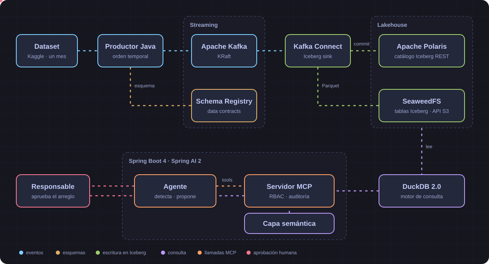
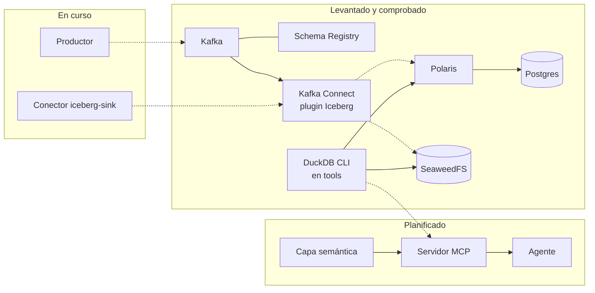
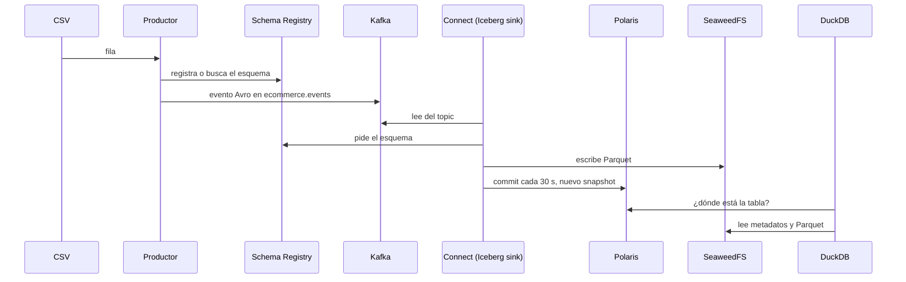
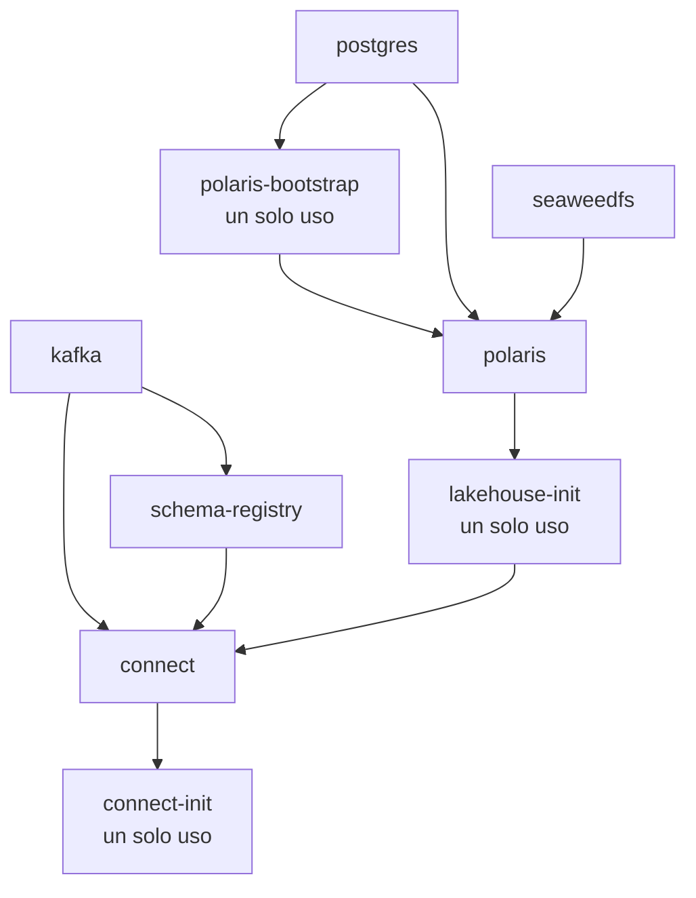

# Arquitectura

[Volver a la portada](README.md) · Términos en el [glosario](01-conceptos.md)

## La imagen entera

Imagina una cadena de montaje con un supervisor al final. Los eventos entran por la izquierda, se archivan en el centro y el agente los consulta a la derecha.

Este dibujo es **el diseño completo, no lo que funciona hoy**. No incluye tres cosas que sí están en [`compose.yaml`](../../compose.yaml): Postgres, los servicios de un solo uso y `tools`. Tampoco a Trino. Esta es la foto de lo que existe, con su estado:

Las líneas discontinuas aún no llevan datos reales.

## El viaje de un evento

En lenguaje llano: un fichero con millones de filas se reproduce como si estuviera pasando ahora, cada fila viaja por Kafka, se archiva en grupos cada medio minuto y queda lista para preguntarle con SQL.

Los pasos 1 a 4 todavía **no se han ejecutado juntos**: es el diseño de T-013, T-012 y T-015. El paso 5 sí se ha probado, con una tabla creada a mano.

1. **Lectura.** `CsvEventReader` convierte cada línea en un registro Avro. Los datos sucios se conservan a propósito; una fila ilegible se cuenta y se salta.
2. **Envío.** `KafkaEventSink` publica en el topic `ecommerce.events`, previsto con 6 particiones.
3. **Escritura.** El sink escribe ficheros Parquet bajo `s3://lakehouse/warehouse/`.
4. **Commit.** Cada 30 segundos (`iceberg.control.commit.interval-ms`) el conector confirma en Polaris. Hasta entonces, los datos escritos no son visibles en la tabla.
5. **Consulta.** DuckDB pide la tabla a Polaris y lee los ficheros directamente de SeaweedFS con su propia clave S3.

## Tabla de conexiones

Red interna: la de Compose, donde cada servicio se alcanza por su nombre. «Publicado» es el puerto accesible desde tu ordenador. Las credenciales son nombres de variables de `.env`.

| Origen | Destino | Protocolo | Puerto interno | Publicado | Credencial | Estado |
|---|---|---|---|---|---|---|
| Schema Registry, Connect | Kafka `INTERNAL` | Kafka PLAINTEXT | 9092 | no | ninguna | ✅ |
| Cliente en tu ordenador | Kafka `EXTERNAL` | Kafka PLAINTEXT | 19092 | 19092 | ninguna | sin probar |
| Controlador KRaft | Kafka `CONTROLLER` | Kafka PLAINTEXT | 9093 | no | ninguna | ✅ |
| Connect, productor, tú | Schema Registry | HTTP | 8081 | 8081 | ninguna | ✅ (productor 🚧) |
| `connect-init`, tú | Connect REST | HTTP | 8083 | 8083 | ninguna | ✅ REST / 🚧 `connect-init` |
| `lakehouse-init`, DuckDB, tú | Polaris API | HTTP + OAuth2 | 8181 | 8181 | `POLARIS_CLIENT_ID`, `POLARIS_CLIENT_SECRET`, `POLARIS_REALM` | ✅ |
| Compose, tú | Polaris gestión | HTTP (`/q/health`) | 8182 | 8182 | ninguna | ✅ |
| Connect (sink) | Polaris API | HTTP + OAuth2 | 8181 | 8181 | las mismas de Polaris | 🚧 T-012 |
| Polaris, `polaris-bootstrap` | Postgres, base `polaris` | PostgreSQL (JDBC) | 5432 | **no** | usuario `polaris`, `POSTGRES_PASSWORD` | ✅ |
| `lakehouse-init`, DuckDB, Polaris | SeaweedFS S3 | HTTP (S3, path-style) | 8333 | 8333 | `S3_ACCESS_KEY`, `S3_SECRET_KEY`, `S3_REGION` | ✅ |
| Connect (sink) | SeaweedFS S3 | HTTP (S3, path-style) | 8333 | 8333 | las mismas de S3 | 🚧 T-012 |
| Healthcheck y tú, dentro del contenedor | SeaweedFS master y filer | HTTP | 9333, 8888 | no | ninguna | ✅ |
| Agente, Claude Desktop | Servidor MCP | HTTP (MCP) | por decidir | por decidir | claves de API previstas | ⬜ T-028, T-050 |
| Agente | API de Anthropic | HTTPS | n/a | n/a | `ANTHROPIC_API_KEY` | ⬜ T-032 |
| Tú | Trino | HTTP | 8080 | 8080, solo con perfil `bench` | sin configurar | ⬜ T-044 |
| Tú | Panel agent-board | HTTP | corre en el host | 8020 | ninguna | ✅ |

## Orden de arranque

Compose respeta las dependencias de [`compose.yaml`](../../compose.yaml). Cada flecha significa «espera a que el otro esté sano» o, en los servicios de un solo uso, «espera a que termine bien».

Por qué en este orden:

- **Postgres, antes que el bootstrap.** La [documentación de Polaris](https://polaris.apache.org/releases/1.8.0/metastores/relational-jdbc/) exige que el esquema exista antes de conectarse. Lo crea [`init.sql`](../../infra/postgres/init.sql) al inicializar el volumen.
- **Bootstrap antes que Polaris.** Prepara las tablas de Polaris y el usuario raíz. En cada `up` vuelve a ejecutarse: si ya está hecho, dice `already bootstrapped; skipping` y termina bien.
- **SeaweedFS antes que Polaris.** Polaris registra tablas cuyos ficheros viven ahí, así que el almacén debe estar listo antes.
- **`lakehouse-init` después de Polaris.** Necesita su API para crear el catálogo `lakehouse`, los permisos y el namespace `ecommerce`. También crea el bucket. Es idempotente: un 409 significa «ya existe».
- **Connect después de Kafka, Schema Registry y `lakehouse-init`.** Los dos primeros los necesita para funcionar. El tercero garantiza que el catálogo existe cuando se registre el sink.
- **`connect-init` después de Connect** (🚧 T-012). Registra el conector con un `PUT`.

`tools` y `trino` están en perfiles, así que `up` no los arranca.

## Memoria

El diseño cuenta con unos 7,6 GB para Docker ([presupuesto en `docs/architecture.md`](../architecture.md#memoria-docker-76-gb)). Compose fija el heap de Java donde hace falta (`-Xmx`), pero **no pone límites de memoria a los contenedores**: las cifras de ese documento son una previsión, no un tope.

Uso observado con `docker stats`, con el stack en reposo y sin datos. Es una lectura puntual, no un benchmark:

| Servicio | Observado | Previsto |
|---|---|---|
| Kafka | 487 MiB | 0,8 GB |
| Schema Registry | 391 MiB | 0,3 GB |
| SeaweedFS | 231 MiB | 0,3 GB |
| Postgres | 35 MiB | 0,2 GB |
| Polaris | 368 MiB | 0,6 GB |
| Connect | 619 MiB | 1,2 GB |
