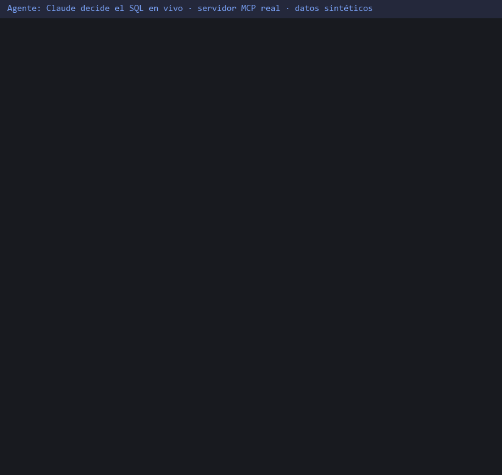
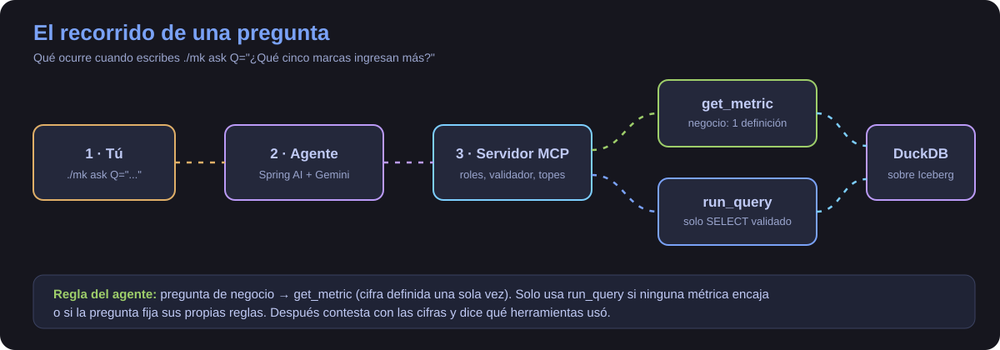

# La demo: una pregunta de principio a fin

> **Estado (8-nov-2026):** la demo está grabada con un agente (Claude) que decide el SQL en vivo contra el servidor MCP real. La demo con el agente propio de Spring AI está ensayada con Gemini, pero no grabada: el cupo gratuito del modelo estaba agotado.

## En una frase

Escribes una pregunta en lenguaje normal, un agente de IA la convierte en una consulta segura sobre los datos y te contesta con cifras.

## Los pasos, para principiantes

1. **Tú preguntas.** `./mk ask Q="¿Qué cinco marcas ingresan más?"`.
2. **El agente** (un programa Java con un modelo de IA) decide qué herramienta necesita.
3. **El servidor MCP** es la puerta: comprueba tu clave (analista o administrador) y solo deja pasar lecturas.
4. **Dos caminos.** Si la pregunta es de negocio, usa `get_metric`: la cifra está definida una sola vez, en un fichero YAML. Si es una consulta suelta («¿cuántas filas hay?»), usa `run_query`, con SQL validado.
5. **DuckDB** lee las tablas de Iceberg y devuelve el resultado; el agente lo explica.

## Para quien ya sabe de esto

- La regla de elección está en el prompt del agente (`agent/src/main/resources/prompts/system.md`): métrica primero, `run_query` solo si ninguna encaja o si la pregunta fija sus propias reglas («sin quitar duplicados», «incluyendo negativos»).
- `top_brands` limpia los datos: `DISTINCT *`, `price > 0` y `user_session` no vacía. Sus cifras no son sumas en crudo.
- `run_query` pasa por un validador de solo lectura y un tope de filas.

## Lo simulado y lo real

| Elemento | Real | Simulado |
|---|---|---|
| Stack, 50 000 filas y claves locales | ✅ | |
| Qué herramientas se llaman y qué SQL se escribe | ✅ lo decide un agente (Claude) sin ver ningún SQL previo | |
| Errores, reintentos y respuestas del servidor | ✅ tal cual salieron | |
| Texto de la respuesta final | ✅ el del agente, completo y sin editar | |
| SQL en pantalla | | 🟡 abreviado; el completo está en `docs/media/live-agent/` |
| La animación del GIF | | 🟡 dibujada con Pillow, no es una captura de pantalla |
| El agente es Claude, no el de Spring AI | | 🟡 el agente Java está ensayado con Gemini, sin grabar |

## Qué se aprendió grabándolo

El primer intento (`round1-before-T-213.jsonl`) fracasó a medias: el agente gastó 8 llamadas probando nombres de tabla y no dio con `lh.ecommerce.events`, así que no pudo calcular los carritos ni la anomalía. La causa era que el servidor que corría no llevaba aún el arreglo T-213 (`queryName` en `list_tables` y sugerencia en el error). Tras reconstruirlo, la segunda ronda (`round2.jsonl`) resolvió la pregunta en 8 llamadas y 1 reintento. También salió que `get_metric` ignora en silencio los argumentos inventados (T-214).

## Cómo se grabó

El agente usa `scripts/demo/mcp_call.py`, que apunta cada llamada en un registro, y `python scripts/demo/record_mcp_demo.py --transcript <registro> --final <respuesta>` dibuja el GIF. Para repetir una versión con el agente Java cuando haya cupo: `python scripts/demo/record_demo.py`. El modo sin agente (SQL fijo de antemano, de la batería de evals) sigue disponible quitando `--transcript`.

## Qué puede fallar

| Síntoma | Causa | Qué hacer |
|---|---|---|
| El agente recibe 401 | Faltan `MCP_ANALYST_KEY` y `MCP_ADMIN_KEY` en `.env` | Añadir dos cadenas aleatorias y `./mk up` |
| Error de nombre de tabla (`Table not allowed`) | `run_query` pide el nombre completo `lh.ecommerce.events` | Escribirlo así (T-213 lo hará explícito) |
| Error de cuota (429) | Se acabaron las 20 peticiones diarias del modelo gratuito | Esperar a la renovación, hacia las 9:00 en España |
| Importes distintos de la referencia | Se cargó la muestra dos veces | No repetir `./mk seed-sample` |
