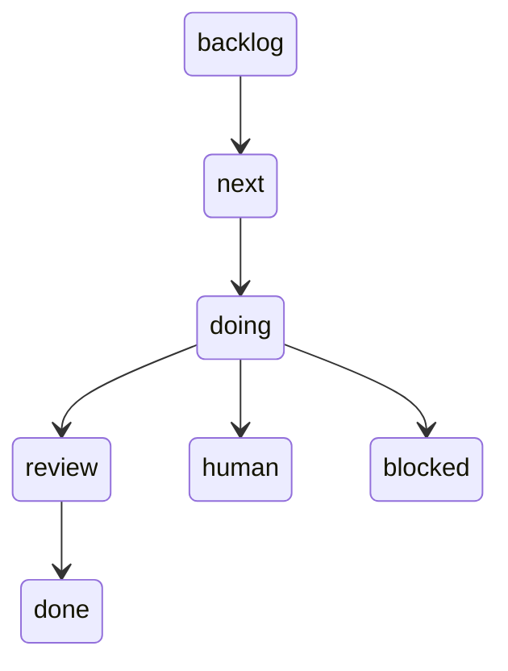

# agent-board

**Estado:** ✅ funciona. Es la herramienta con la que se construye el proyecto, no parte del lakehouse.

[Portada](../README.md) · [Glosario](../01-conceptos.md)

## Qué es, en cristiano

Un tablero de tareas, como los de notas adhesivas, donde parte del trabajo lo hace un equipo de agentes de Claude Code: arquitecto, desarrollador, tester, investigador y experto. Cada tarjeta tiene su responsable, su estimación y su historial.

## Para qué está aquí y qué pasaría sin él

Hace que el trabajo sea visible y trazable. Sin él, los agentes trabajarían sin una lista común, y no habría forma de saber qué está hecho y qué no. En esta wiki, las referencias tipo `T-012` apuntan a sus tarjetas.

## Cómo se conecta

| Dirección | Quién | Puerto |
|---|---|---|
| Entrada | Tu navegador | 8020, en tu ordenador, fuera de Docker |
| Salida | `claude -p --agent <rol>`, lanzado por el runner | proceso local |
| Almacén | [`board/board.json`](../../../board/board.json) | fichero |

No se conecta con el stack. Los tests de `./mk test-board` lo usan sobre una copia ([`tests/conftest.py`](../../../tests/conftest.py)).

## Cómo funciona por dentro



- [`board/board.py`](../../../board/board.py): la interfaz de línea de comandos. El JSON nunca se edita a mano.
- [`board/server.py`](../../../board/server.py): el panel web, con FastAPI.
- [`board/runner.py`](../../../board/runner.py): elige tarea por estado y prioridad (primero `review`, luego `next` y `backlog`) y lanza al agente. Cada carril (`think`, `measure`) trabaja en paralelo y solo hace commit de lo que cambió.
- [`.claude/agents/`](../../../.claude/agents/tester.md): las instrucciones de cada rol.
- `human` significa «solo lo puede hacer la responsable», y `blocked`, que espera otra cosa.

## Cómo está configurado aquí

Las reglas están en [`CLAUDE.md`](../../../CLAUDE.md). Los permisos de los agentes están en listas `ALLOWED` y `DENIED` en `runner.py`, más [`board/permissions.json`](../../../board/permissions.json). Por eso los agentes no pueden hacer `git commit`: los commits los hace el runner.

## Cómo probarlo tú mismo

Solo lectura:

```bash
python board/board.py list
```
```text
T-001  done     consultor     est 45.0 min · real    –  Fase 0: dejar el entorno levantado
T-002  done     desarrollador est 45.0 min · real    5  Infra: que el catálogo sobreviva a un reinicio de Polaris
...
```

Panel: `python board/server.py` y abre `http://localhost:8020`. Se comprobó que responde con HTTP 200 uno ya arrancado. **Sin probar:** arrancarlo desde cero, ya que requiere FastAPI y uvicorn en el Python del host. El runner no se ha ejecutado para esta wiki.

## Qué puede fallar

- **Tarjeta `done` sin su código.** Ocurre hoy: [T-011 está cerrada y sus clases no están en la rama](productor.md). Los commits del runner a veces solo contienen el cambio de estado. Cerrar una tarjeta no prueba que el código esté subido.
- **Corte por límite de uso, o agente que termina sin mensaje final.** La tarjeta vuelve a su estado sin contar como fallo y el runner para hasta la siguiente ejecución (T-013, T-084). Puede dejar ficheros a medias en la rama.
- **Pausa automática.** Tres fallos seguidos del agente (error o tiempo agotado; un `RESULT: blocked` no cuenta) pausan el carril, y el panel muestra el motivo en «En pausa: …» (T-084).
- **Mensaje ilegible en una tarjeta.** T-012 pasó a `blocked` con un trozo de salida JSON en vez de un motivo, justo cuando el tester se cortó.
- **Comandos denegados.** Quedan anotados en la tarjeta.

## Para saber más

- [agent-board en GitHub](https://github.com/AlbaAsca/agent-board)
- [Claude Code](https://docs.claude.com/en/docs/claude-code/overview)
