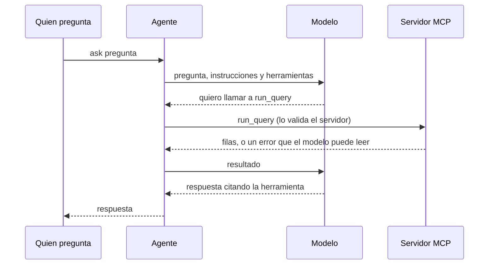
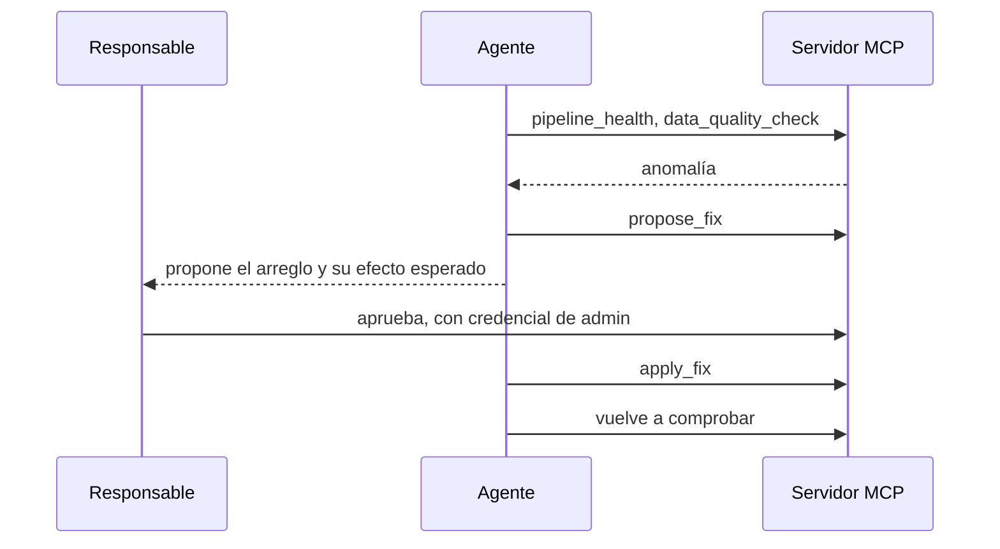

# Agente

**Estado:** 🟡 primera versión (T-094). Contesta una pregunta consultando los datos por MCP, comprobado con un modelo simulado contra la imagen real del servidor. **Sin probar:** con un modelo de verdad, Gemini o Claude (T-097). Lo demás sigue planificado: comando en el stack (T-096), métricas (T-034), topes de tokens y gasto (T-035), investigar y reparar (T-036, T-042). Sin precisión publicada: las evals tampoco existen (T-048, T-056, T-061).

[Portada](../README.md) · [Glosario](../01-conceptos.md)

## Qué es, en cristiano

Un analista junior incansable. Le preguntas «¿por qué cayeron las compras ayer?», y va pidiendo datos, mirando lo que recibe y decidiendo el siguiente paso. Si encuentra una avería, puede escribir un parte con el arreglo, pero necesita que una persona lo firme.

Hoy solo hace la primera parte: pregunta, consulta y respuesta. Vigilar y reparar llegan después.

## Para qué está aquí y qué pasaría sin él

Es el protagonista de la demo: el resto del proyecto existe para que pueda trabajar con seguridad. Sin él, el lakehouse seguiría siendo útil, pero alguien tendría que consultar y vigilar a mano. También se podrá usar Claude Desktop como cliente (T-028, T-030).

## Cómo se conecta

| Dirección | Quién | Credencial |
|---|---|---|
| Salida | [Servidor MCP](servidor-mcp.md), en `MCP_SERVER_URL` | ninguna; clave de API prevista (T-050) |
| Salida | API de Gemini (por defecto) | `GEMINI_API_KEY` |
| Salida | API de Anthropic (si se elige) | `ANTHROPIC_API_KEY` |

## Cómo funciona por dentro hoy



El bucle lo lleva el `ToolCallingAdvisor` que registra `ChatClient`: en Spring AI 2 el `ChatModel` ya no ejecuta herramientas por su cuenta. Las instrucciones están en [`prompts/system.md`](../../../agent/src/main/resources/prompts/system.md): no inventar cifras y citar la herramienta usada.

## Cómo funcionará cuando repare



Es el ciclo de self-healing del [brief](../../brief.md#funcionalidades-clave): detectar, diagnosticar, proponer, aplicar con aprobación y verificar. Según la [decisión 9](../../architecture.md#decisiones), el agente no puede aprobar sus propios arreglos, porque nunca recibe esa credencial.

Fallos previstos en `make chaos`: schema drift, duplicados, consumidor caído y partición vacía (T-037 a T-041).

## Cómo está configurado

Todo en [`application.yaml`](../../../agent/src/main/resources/application.yaml), por variables de entorno:

| Variable | Por defecto | Para qué |
|---|---|---|
| `AGENT_PROVIDER` | `google-genai` | `google-genai` o `anthropic`: ambos van en el jar y solo arranca el elegido |
| `AGENT_MODEL` | `gemini-2.5-flash` con Gemini; obligatoria con Claude | El modelo. Vacía cuenta como no definida: `ask.sh` la quita antes de arrancar Java, porque compose la pasa vacía si falta en `.env` |
| `GEMINI_API_KEY`, `ANTHROPIC_API_KEY` | vacías | Solo se exige la del proveedor elegido |
| `AGENT_MAX_TOOL_CALLS` | `10` | Tope de llamadas a herramientas por pregunta |
| `AGENT_MODEL_TIMEOUT` | `300s` | Tiempo máximo de una pregunta entera (modelo y herramientas); `0s` lo desactiva. Al pasarse, una línea en stderr y código 6 |
| `MCP_SERVER_URL` | `http://localhost:8090` | Dónde está el servidor |
| `AGENT_MCP_TIMEOUT` | `60s` | Espera máxima de cada llamada al servidor |

**Sin comprobar:** que `gemini-2.5-flash` siga en la capa gratuita de Gemini. La documentación actual de Google no se ha podido consultar; el nombre solo consta en la lista de modelos de Spring AI 2.0.2, que no dice nada de precios. Se cambia con `AGENT_MODEL`, sin tocar código.

**Para usar Claude:** `AGENT_PROVIDER=anthropic`, `ANTHROPIC_API_KEY` y `AGENT_MODEL`.

**El tope** usa el de Spring AI (`spring.ai.tools.limits.max-total-tool-calls`) y cuenta llamadas, no vueltas: cinco llamadas en una misma respuesta gastan cinco. Tokens y gasto siguen pendientes (T-035).

**Thought signatures de Gemini 3.** Gemini 3 exige que cada llamada a una herramienta vuelva con la firma con la que llegó. Spring AI 2.0.2 la guarda en los metadatos del mensaje y la repone al reenviarlo; un test comprueba que el bucle no los pierde. Falta verlo con Gemini de verdad (T-097).

## Cómo probarlo tú mismo

```bash
./mk test MODULE=agent   # sin clave de API: el modelo está simulado y el servidor es la imagen real
```

Un modelo simulado pide un `count(*)` y la cifra que llega a la respuesta es la que escribió el cargador de datos, que nunca pasó por el servidor. Otro no termina nunca y se corta en el tope.

`AgentImageIT` arranca la imagen del servicio `agent` contra un modelo simulado en otro contenedor: la pregunta, con espacios y comillas, llega entera al modelo y su respuesta sale por stdout. Sin clave, la imagen termina con código 5 diciendo cuál falta.

Con un modelo de verdad, **sin probar** (T-097): con el stack levantado y la muestra cargada,

```bash
./mk ask Q="Which five brands have the highest purchase revenue? Sum the price of every purchase row as stored (no deduplication, negative prices included, ignore empty brands)."
```

Detalles de comillas y del arranque en [Operación](../04-operacion.md#preguntar-al-agente).

## Cómo termina

| Salida | Cuándo | Dónde escribe |
|---|---|---|
| 0 | Hay respuesta | stdout |
| 1 | Fallo: el proveedor o el servidor MCP no responden, falta la clave, o el modelo termina sin decir nada | stderr o el log |
| 2 | La orden no es `ask <pregunta>` | stderr |
| 3 | Ha llegado al tope de llamadas | stderr |
| 4 | Se ha agotado la cuota del proveedor (error 429) | stderr |
| 6 | La pregunta ha pasado de `AGENT_MODEL_TIMEOUT` sin respuesta (modelo colgado o muy lento) | stderr |
| 5 | Solo en la imagen (`./mk ask` lo muestra como `Error 5` de make pero sale con 2): falta la clave del proveedor elegido, o `AGENT_MODEL` con Claude, o `AGENT_PROVIDER` no es válido | stderr |

## Qué puede fallar

- **Cuota de la capa gratuita.** Un 429 se informa como cuota, con lo que diga el proveedor y sin hacerlo pasar por una respuesta. Ojo: un modelo sin capa gratuita también puede contestar 429.
- **Servidor MCP caído.** El agente no arranca y suelta una traza larga de Spring que termina en `Client failed to initialize`.
- **Coste.** Cada vuelta del bucle se paga con Claude y gasta cuota con Gemini, de ahí el tope y una [evaluación acotada](../../architecture.md#decisiones) (decisión 17).
- **Inventar cifras.** Las instrucciones lo prohíben, pero nada lo garantiza todavía: lo medirán las evals.
- **SQL libre del modelo.** Las instrucciones piden usar `list_metrics`/`get_metric` para las preguntas de negocio y `run_query` solo si ninguna métrica encaja (T-034), pero nada obliga al modelo: si escribe su SQL, pasa por el [validador](servidor-mcp.md#el-validador-de-sql). Un test con modelo simulado comprueba que la llamada a `get_metric` llega al servidor real y su resultado a la respuesta; que un modelo real la prefiera lo medirán las evals.
- **Depender de un modelo.** Los tests usan un modelo simulado, así que no detectan cambios en la API del proveedor.

## Para saber más

- [Agentes y herramientas en MCP](https://modelcontextprotocol.io/docs/getting-started/intro)
- [Spring AI](https://docs.spring.io/spring-ai/reference/)
