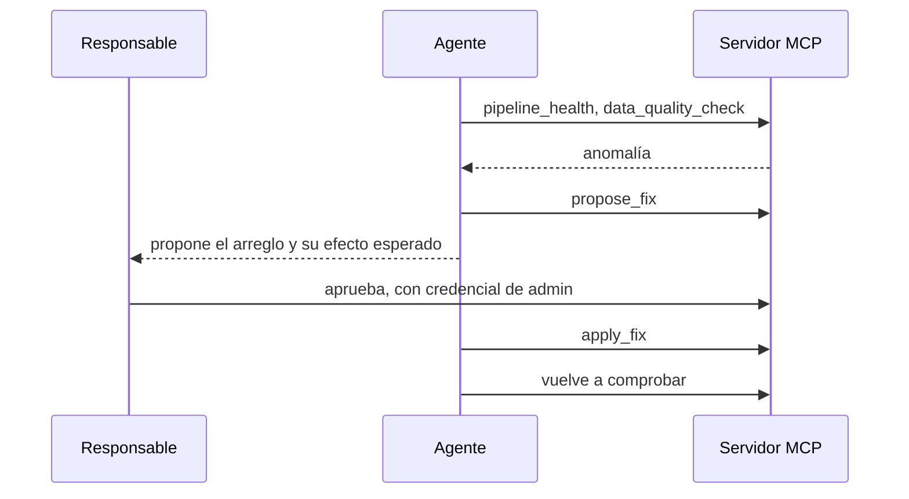

# Agente

**Estado:** ⬜ planificado. Solo existe [`agent/pom.xml`](../../../agent/pom.xml). Tarjetas T-032, T-034 a T-036 y T-042. Sin precisión publicada: las evals tampoco existen (T-048, T-056, T-061).

[Portada](../README.md) · [Glosario](../01-conceptos.md)

## Qué es, en cristiano

Un analista junior incansable. Le preguntas «¿por qué cayeron las compras ayer?», y va pidiendo datos, mirando lo que recibe y decidiendo el siguiente paso. Si encuentra una avería, puede escribir un parte con el arreglo, pero necesita que una persona lo firme.

## Para qué estará aquí y qué pasaría sin él

Es el protagonista de la demo: el resto del proyecto existe para que pueda trabajar con seguridad. Sin él, el lakehouse seguiría siendo útil, pero alguien tendría que consultar y vigilar a mano. También se podrá usar Claude Desktop como cliente (T-028, T-030).

## Cómo se conectará

| Dirección | Quién | Credencial |
|---|---|---|
| Salida | [Servidor MCP](servidor-mcp.md) | clave de API prevista (T-050) |
| Salida | API de Anthropic | `ANTHROPIC_API_KEY` (T-032) |

## Cómo funcionará por dentro

Es el ciclo de self-healing del [brief](../../brief.md#funcionalidades-clave): detectar, diagnosticar, proponer, aplicar con aprobación y verificar. Según la [decisión 9](../../architecture.md#decisiones), el agente no puede aprobar sus propios arreglos, porque nunca recibe esa credencial.

Fallos previstos en `make chaos`: schema drift, duplicados, consumidor caído y partición vacía (T-037 a T-041).

## Cómo estará configurado

Previsto en T-034: `ChatClient` de Spring AI 2.0.2, cliente MCP y modelo por configuración (`AGENT_MODEL`). Topes de iteraciones, tokens y gasto en T-035. Dependencias ya en el `pom.xml`: `spring-ai-starter-mcp-client` y `spring-ai-starter-model-anthropic`.

`ANTHROPIC_API_KEY` ya figura vacía en [`.env.example`](../../../.env.example). Hoy nada la usa.

## Cómo probarlo tú mismo

Todavía no se puede. `./mk demo`, `./mk chaos` y `./mk evals` responden `not implemented yet`.

## Qué puede fallar

Riesgos de diseño:

- **Coste.** Cada vuelta del bucle se paga, de ahí los topes y una [evaluación acotada](../../architecture.md#decisiones) (decisión 17).
- **Inventar cifras.** T-034 pide al prompt que no lo haga. Las evals medirán si lo cumple.
- **Depender de un modelo.** Los tests usan un modelo simulado.

## Para saber más

- [Agentes y herramientas en MCP](https://modelcontextprotocol.io/docs/getting-started/intro)
- [Spring AI](https://docs.spring.io/spring-ai/reference/)
