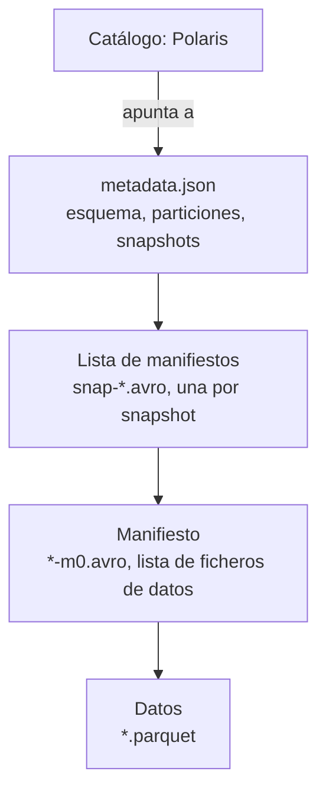

# Apache Iceberg

**Estado:** ✅ funciona con tablas de prueba. ⬜ La tabla de eventos real aún no existe (T-015). ⬜ Compactación y evolución de esquema: T-047 y T-045.

[Portada](../README.md) · [Glosario](../01-conceptos.md)

## Qué es, en cristiano

Iceberg no es un programa, es un conjunto de reglas: un [formato de tabla](../01-conceptos.md#formato-de-tabla). Imagina un álbum de fotos con un índice. Las fotos son ficheros [Parquet](../01-conceptos.md#parquet) que nunca se tocan. Cada cambio añade una página nueva al índice que dice «ahora la tabla son estas fotos». Cambiar la tabla es cambiar a qué página apunta el índice.

## Para qué está aquí y qué pasaría sin él

Convierte una carpeta de ficheros en una tabla fiable. Sin él, un lector podría ver un fichero a medias, nadie sabría qué ficheros cuentan, y volver atrás tras un error sería imposible. Es lo que permite al agente hacer *time travel* y al arreglo deshacer cambios.

## Cómo se conecta

No se conecta: no hay ningún contenedor llamado Iceberg. Lo implementan quienes leen y escriben.

| Quién | Cómo lo usa | Estado |
|---|---|---|
| [DuckDB](duckdb.md) | Extensión `iceberg` | ✅ |
| [Kafka Connect](kafka-connect.md) | Plugin sink | 🚧 |
| [Polaris](polaris.md) | Implementa el catálogo REST de Iceberg | ✅ |
| [SeaweedFS](seaweedfs.md) | Guarda metadatos y datos | ✅ |
| [Servidor MCP](servidor-mcp.md) | A través de DuckDB, previsto | ⬜ |
| [Trino](trino.md) | Benchmark y quizá expiración, pendiente de T-087 | ⬜ |

## Cómo funciona por dentro

Según la [especificación](https://iceberg.apache.org/spec/), hay varias capas de ficheros:



Cada cambio escribe un `metadata.json` nuevo, y el commit es un intercambio atómico del fichero de metadatos vigente. Si dos escriben a la vez, el segundo reintenta sobre la versión nueva.

Esto se ve en la práctica. Una tabla con dos `INSERT` deja estos 9 objetos: 2 Parquet, 3 `metadata.json` (crear + 2 inserts), 2 listas y 2 manifiestos.

```text
warehouse/wiki_demo/eventos/data/….parquet
warehouse/wiki_demo/eventos/data/….parquet
warehouse/wiki_demo/eventos/metadata/snap….avro
warehouse/wiki_demo/eventos/metadata/snap….avro
warehouse/wiki_demo/eventos/metadata/….metadata.json
warehouse/wiki_demo/eventos/metadata/….metadata.json
warehouse/wiki_demo/eventos/metadata/….metadata.json
warehouse/wiki_demo/eventos/metadata/…m0.avro
warehouse/wiki_demo/eventos/metadata/…m0.avro
```

## Cómo está configurado aquí

No hay un fichero de Iceberg: la configuración está repartida.

- **Ubicación de tablas:** `default-base-location` `s3://lakehouse/warehouse`, en [`infra/polaris/init.sh`](../../../infra/polaris/init.sh).
- **Tabla prevista:** `ecommerce.events`, partición `day(event_time),event_type`, en [`connect/iceberg-sink.json`](../../../connect/iceberg-sink.json).
- **Versión de la biblioteca en el sink:** [ver la nota](kafka-connect.md#cómo-está-configurado-aquí).
- **Evolución automática de esquema:** apagada a propósito.

## Cómo probarlo tú mismo

El recorrido completo, con snapshots y time travel, está en [el tutorial](../03-probarlo.md#paso-5-crea-una-tabla). Solo hace falta DuckDB.

## Qué puede fallar

- **Muchos ficheros pequeños.** Con commits cada 30 s se acumularán. Hace falta compactar (⬜ T-047).
- **Borrar una tabla no borra sus ficheros.** Comprobado aquí con DuckDB y Polaris: tras `DROP TABLE` siguen los objetos en S3. [Detalle](../04-operacion.md#drop-table-deja-los-ficheros-en-s3).
- **El catálogo y los ficheros son dos cosas.** Si se pierde el catálogo, los ficheros siguen, pero nadie sabe qué tabla forman. Por eso [Polaris guarda en Postgres](postgres.md).

## Para saber más

- [Especificación de Iceberg](https://iceberg.apache.org/spec/)
- [Documentación de Iceberg](https://iceberg.apache.org/docs/latest/)
