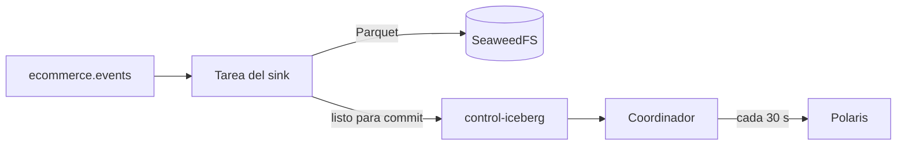

# Kafka Connect y el sink de Iceberg

**Estado:** ✅ La tarea sale `RUNNING` y un evento acaba como fila de la tabla: lo comprueba `IcebergSinkFlowIT` en contenedores (T-072). **Sin probar:** `./mk up` en el stack completo y el mes real con `./mk seed`.

[Portada](../README.md) · [Glosario](../01-conceptos.md)

## Qué es, en cristiano

El operario entre la cinta y el archivo. Kafka Connect es un programa que mueve datos entre Kafka y otros sistemas sin que escribas código: le das una configuración y un plugin. El *sink* de Iceberg es el plugin que recoge eventos de la cinta y los archiva como tablas.

## Para qué está aquí y qué pasaría sin él

Convierte el flujo de eventos en tablas consultables. Sin él habría que escribir un consumidor propio que resolviera lo difícil: agrupar en ficheros, confirmar en el catálogo y no duplicar nada tras un fallo.

## Cómo se conecta

| Dirección | Quién | Puerto |
|---|---|---|
| Entrada | [Kafka](kafka.md): topic `ecommerce.events` | 9092 interno |
| Entrada | [Schema Registry](schema-registry.md): esquema Avro | 8081 |
| Salida | [SeaweedFS](seaweedfs.md): ficheros de datos | 8333, `S3_ACCESS_KEY`, `S3_SECRET_KEY` |
| Salida | [Polaris](polaris.md): commits | 8181, `POLARIS_CLIENT_ID`, `POLARIS_CLIENT_SECRET` |
| Control | API REST | 8083, publicado |

Connect guarda su estado en tres topics de Kafka: `_connect-configs`, `_connect-offsets` y `_connect-status`.

## Cómo funciona por dentro

Según la [documentación de Iceberg](https://iceberg.apache.org/docs/latest/kafka-connect/), el sink escribe ficheros de datos continuamente, y un coordinador hace el commit en cada intervalo, avisando a través de un topic de control (`control-iceberg` por defecto). La documentación anuncia entrega *exactly-once*, apoyada en las transacciones de Kafka. Aquí no se ha comprobado: lo cubrirá T-015.



## Cómo está configurado aquí

**Worker.** Servicio `connect` en [`compose.yaml`](../../../compose.yaml), imagen construida con [`infra/connect/Dockerfile`](../../../infra/connect/Dockerfile) sobre `confluentinc/cp-kafka-connect:8.1.0`. No es la 8.4.0 de Schema Registry: con ella [la tarea no arranca](../04-operacion.md#el-conector-sale-failed).

| Opción | Valor | Por qué |
|---|---|---|
| `CONNECT_OFFSET_FLUSH_INTERVAL_MS` | `1000` | Con los 60 s por defecto, [el commit nunca llega con el topic parado](../04-operacion.md#la-tarea-sale-running-pero-la-tabla-no-aparece) |
| `CONNECT_VALUE_CONVERTER` | `AvroConverter` | Los eventos son Avro |
| `CONNECT_PLUGIN_PATH` | incluye `/opt/connectors` | Donde queda el plugin compilado |
| `KAFKA_HEAP_OPTS` | `-Xmx1g` | Presupuesto de memoria |
| `AWS_*` | `S3_REGION`, `S3_ACCESS_KEY`, `S3_SECRET_KEY` | Claves estáticas: [no hay STS](../05-decisiones.md#seaweedfs-sin-sts) |

**Plugin.** No hay zip publicado: la documentación indica que se genera con el build. El Dockerfile clona la etiqueta `apache-iceberg-1.12.0` y ejecuta el `distZip`. Se usa `git clone` y no un tarball [porque el build necesita `.git`](../04-operacion.md#el-conector-de-iceberg-no-se-puede-descargar).

El Dockerfile escribe también `version.txt`. Sin ese fichero, el plugin compilado de la etiqueta 1.12.0 se anunciaba como `1.13.0-SNAPSHOT`; con él se anuncia como `1.12.0`, y `IcebergSinkFlowIT` lo comprueba.

**Conector.** [`connect/iceberg-sink.json`](../../../connect/iceberg-sink.json), registrado por el servicio de un solo uso `connect-init` con [`connect/register.sh`](../../../connect/register.sh).

| Opción | Valor | Por qué |
|---|---|---|
| `iceberg.tables` | `ecommerce.events` | Tabla destino |
| `iceberg.tables.auto-create-enabled` | `true` | Crea la tabla, no el namespace: lo crea `init.sh` |
| `iceberg.tables.evolve-schema-enabled` | `false` | El *schema drift* debe ser un fallo detectable ([decisión 3](../../architecture.md#decisiones)) |
| `iceberg.tables.default-partition-by` | `day(event_time),event_type` | El particionado del brief |
| `iceberg.control.commit.interval-ms` | `30000` | La documentación da 5 minutos por defecto. 30 s dan una demo más viva a cambio de más ficheros |
| `transforms.eventTime` | `TimestampConverter` | El [README de `connect/`](../../../connect/README.md) explica que el conversor entrega `timestamp-micros` como un `long`, y `day()` no podría particionarlo |
| `errors.tolerance`, `errors.deadletterqueue.topic.name` | `all`, `ecommerce.events.dlq` | Los mensajes ilegibles van aparte. Según ese README, un error al escribir sigue parando la tarea |
| `iceberg.catalog.s3.*` | endpoint de SeaweedFS, path-style y claves | Sin credential vending |

## Cómo probarlo tú mismo

La prueba completa está en `./mk test`: `IcebergSinkFlowIT` levanta el worker y el catálogo en contenedores, envía un evento, espera la tarea `RUNNING` y lee la fila campo a campo con DuckDB. Tarda unos 3 minutos, más la compilación de Iceberg si cambia su imagen.

Sobre el stack levantado (**sin probar** tras T-072; las salidas son las esperadas):

```bash
curl -s localhost:8083/
```
```text
{"version":"8.1.0-ccs","commit":"...","kafka_cluster_id":"..."}
```

El plugin está cargado:

```bash
curl -s localhost:8083/connector-plugins
```
```text
[{"class":"org.apache.iceberg.connect.IcebergSinkConnector","type":"sink","version":"1.12.0"}, ...]
```

El conector está registrado, y tanto él como su tarea salen `RUNNING`:

```bash
curl -s localhost:8083/connectors/iceberg-sink/status
```

## Qué puede fallar

- **`connect-init` termina con error.** Si falta una variable de `.env` o Connect rechaza la configuración, [`register.sh`](../../../connect/register.sh) para. Mientras Connect arranca (sin respuesta, 404, 409 o 5xx) reintenta durante unos 2 minutos. Mira `docker compose logs connect-init`.
- **El primer `up` tarda varios minutos.** Compila Iceberg entero, y requiere acceso a GitHub.
- **La tarea pasa a `FAILED`.** El motivo está en el campo `trace` de `/connectors/iceberg-sink/status`.
- **La tarea sale `RUNNING` y la tabla no aparece.** Los commits van cada 30 s, así que espera un poco. Si no, mira [la guía de diagnóstico](../04-operacion.md#la-tarea-sale-running-pero-la-tabla-no-aparece).
- **Cambias el esquema y deja de escribir.** Es lo buscado, con la evolución apagada.
- **`up` sigue sin registrar el conector.** Contenedores anteriores a T-012: `./mk up` debe crear `connect-init`.

## Para saber más

- [Iceberg Kafka Connect](https://iceberg.apache.org/docs/latest/kafka-connect/)
