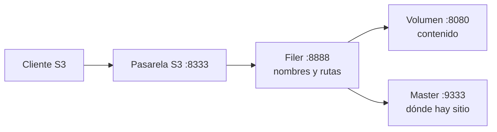

# SeaweedFS

**Estado:** ✅ funciona.

[Portada](../README.md) · [Glosario](../01-conceptos.md)

## Qué es, en cristiano

El almacén de cajas. Tú le das un fichero y un nombre, y te lo devuelve cuando se lo pidas. Habla el mismo idioma que Amazon [S3](../01-conceptos.md#s3), de modo que cualquier programa pensado para S3 funciona con él, pero en tu ordenador y gratis.

## Para qué está aquí y qué pasaría sin él

Es donde viven de verdad los datos: Parquet y metadatos de [Iceberg](iceberg.md). Sin él habría que pagar S3 real o usar otro servidor compatible. Se eligió frente a MinIO porque [su repositorio comunitario está archivado](../05-decisiones.md#seaweedfs-frente-a-minio).

## Cómo se conecta

| Dirección | Quién | Puerto |
|---|---|---|
| Entrada | [DuckDB](duckdb.md), [Polaris](polaris.md), `lakehouse-init`, [Connect](kafka-connect.md) (🚧) | 8333, publicado, API S3 |
| Interno | Healthcheck, master | 9333 |
| Interno | Filer | 8888 |
| Interno | Volumen | 8080 |

La credencial es la pareja `S3_ACCESS_KEY` y `S3_SECRET_KEY`.

## Cómo funciona por dentro

La [wiki oficial](https://github.com/seaweedfs/seaweedfs/wiki/Amazon-S3-API) explica que `weed server -s3` arranca a la vez un *master*, un servidor de *volúmenes*, un *filer* y la pasarela S3:



Los buckets aparecen en el filer bajo `/buckets/`.

## Cómo está configurado aquí

Servicio `seaweedfs` en [`compose.yaml`](../../../compose.yaml), imagen [`infra/seaweedfs/Dockerfile`](../../../infra/seaweedfs/Dockerfile) sobre `chrislusf/seaweedfs:4.51`.

[`start.sh`](../../../infra/seaweedfs/start.sh) escribe la identidad S3 en `/tmp/s3.json` al arrancar, a partir del entorno, para que ninguna credencial quede dentro de la imagen.

| Opción | Valor | Por qué |
|---|---|---|
| `-s3 -s3.port=8333` | Pasarela S3 | La API que usan todos |
| `-s3.config` | `/tmp/s3.json` | Una sola identidad, `lakehouse`, con `Admin`, `Read`, `List`, `Tagging` y `Write` |
| `-volume.max=20` | Máximo de volúmenes | Valor elegido en el repo |
| Volumen | `seaweedfs-data:/data` | Persistencia |
| STS | no configurado | La [wiki de SeaweedFS](https://github.com/seaweedfs/seaweedfs/wiki/Amazon-S3-API) lista operaciones STS, pero este proyecto no las activa: [decisión](../05-decisiones.md#seaweedfs-sin-sts) |

## Cómo probarlo tú mismo

Salud del master, dentro del contenedor:

```bash
docker compose exec -T seaweedfs wget -qO- http://127.0.0.1:9333/cluster/healthz
```

Termina con código 0 y sin salida.

Responde en S3 y exige credenciales:

```bash
curl -s -o /dev/null -w '%{http_code}\n' localhost:8333/
```
```text
403
```

Listar objetos con DuckDB, que ya tiene las credenciales:

```bash
docker compose run --rm -T tools sh docs/wiki/ejemplos/lh.sh "SELECT count(*) AS total FROM glob('s3://lakehouse/**');"
```

El resultado depende de lo que hayas hecho. La imagen `tools` no trae `aws`.

Versión:

```bash
docker compose exec -T seaweedfs weed version
```
```text
version 30GB 4.51 ffa87c25f linux amd64
```

## Qué puede fallar

- **Error 403.** Sin credenciales o con unas que no coinciden con `.env`. Cambiar `S3_SECRET_KEY` exige recrear el contenedor, porque el fichero se genera al arrancar.
- **Direcciones `bucket.seaweedfs`.** Hay que usar path-style: `pathStyleAccess` en Polaris y `URL_STYLE 'path'` en DuckDB.
- **Ficheros huérfanos.** [`DROP TABLE` no los borra](../04-operacion.md#drop-table-deja-los-ficheros-en-s3).
- **Se alcanza `-volume.max`.** En una lectura de `/dir/status`, el stack tenía 14 de 20 volúmenes con muy pocos datos. Sin probar qué pasa al cargar el mes real: T-018.

## Para saber más

- [API S3 de SeaweedFS](https://github.com/seaweedfs/seaweedfs/wiki/Amazon-S3-API)
